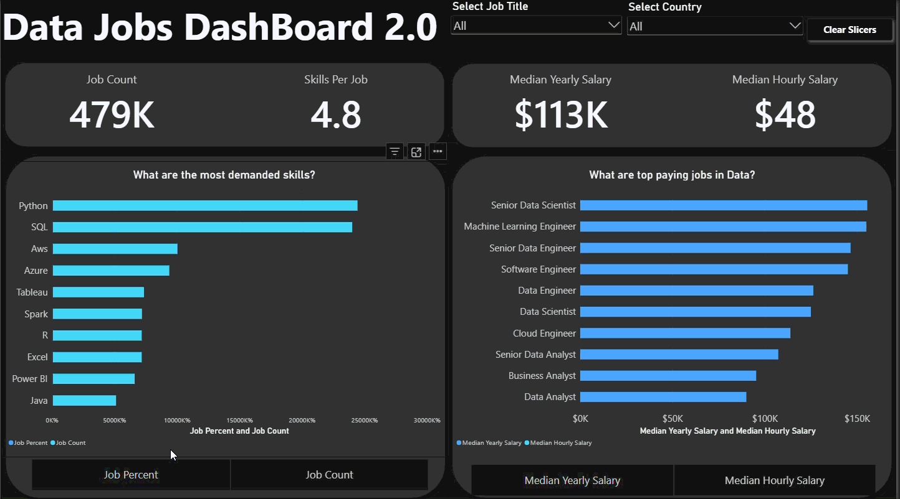
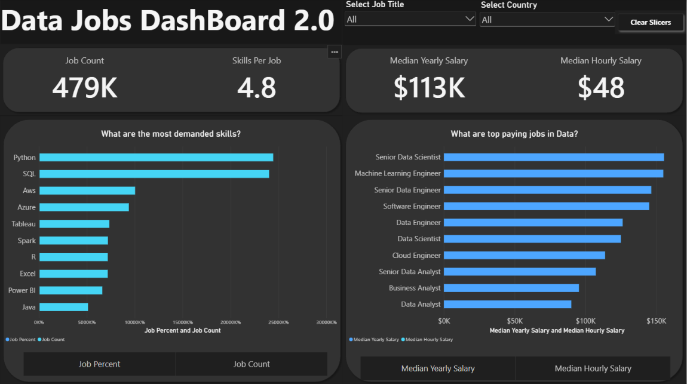

# Data Jobs Dashboard v2 w/ Power BI

## Introduction

Navigating the data job market can feel like a maze, with information scattered everywhere. This dashboard (V2.0) is designed specifically for **Job Seekers, Job Transitioners, and Job Swappers** to cut through the clutter. Using a real-world dataset of 2024 data science job postings—including details on job titles, salaries, and locations—this project provides a streamlined interface to explore market trends and compensation insights.

### Dashboard File

You can find the Power BI dashboard file here: [`Data_Jobs_Dashboard_2.0.pbix`](Data_Jobs_Dashboard_2.0.pbix).

## Skills Showcased

This project put key Power BI features into practice:

- **Dashboard Design:** Creating an intuitive and visually appealing report layout.
- **Power Query ETL:** Performing data cleaning, shaping, and transformation.
- **Data Modeling:** Building relationships between tables to support analysis.
- **DAX Fundamentals:** Creating calculations, measures, and aggregations to derive insights.
- **Visualizations Utilized:**
  - **Core Charts:** Column, bar, line, and area charts for comparisons and trends.
  - **Map Charts:** Displaying the geographical distribution of job postings.
  - **Cards:** Highlighting key performance indicators.
  - **Tables:** Presenting detailed information.
  - **Chart Variety:** Selecting appropriate visuals to communicate data effectively.
- **Interactive Features:**
  - **Slicers:** Enabling dynamic, user-driven filtering.
  - **Buttons and Bookmarks:** Supporting navigation and interactive report views.
  - **Drill-Through:** Enabling more detailed analysis of selected job categories.

---

## Dashboard Overview (Version 2.0 — Single-Page Focus)

This second iteration consolidates the dashboard into a **single, focused page**, designed to give job seekers key market insights at a glance.

This page serves as an overview of the data job market. It showcases key performance indicators (KPIs), including **Job Count, Skills Per Job, Median Yearly Salary, and Median Hourly Salary**. It also visualizes the most demanded skills and compares salaries across different data job titles, providing a concise view of market demand and compensation.

---

## Conclusion

This updated dashboard demonstrates how Power BI can transform job-posting data into an interactive tool for exploring the data job market. By combining data preparation, data modeling, DAX calculations, and visualization, the project provides a practical way to investigate job demand, salary trends, and skill popularity.