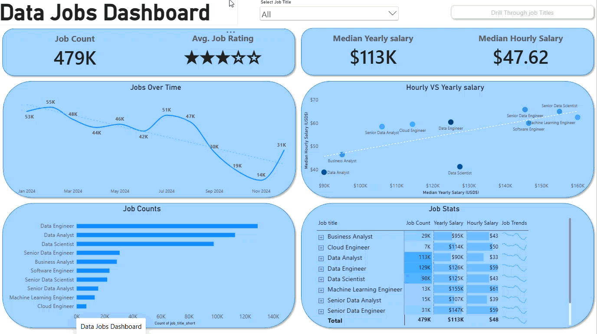

# Power BI Projects Portfolio

Welcome to my Power BI portfolio. This repository showcases my
projects in data analysis, data visualization, and business intelligence.

## Projects

### 1. Data Jobs Dashboard — Version 1

An interactive dashboard exploring the data job market, including
job demand, salary trends, and job characteristics.

**Tools:** Power BI, Power Query, DAX

[View Project 1](Data_Jobs_v1/README.md)

---

### 2. Data Jobs Dashboard — Version 2.0

An updated dashboard focused on job-market KPIs, in-demand skills,
and salary comparisons across data-related job titles.

**Tools:** Power BI, Power Query, DAX

[View Project 2](Data_Jobs_v2/Readme.md)

---

## Skills

- Data cleaning and transformation with Power Query
- Data modeling and relationships
- DAX measures and calculations
- KPI development
- Interactive dashboards and slicers
- Data visualization and analytical reporting